<div align="center">


# Brim

**Your notch, put to work.**

Screenshots, a file tray, clipboard history, music and live activities,
living in your Mac's notch.

[](https://github.com/CezarProX/brim/releases/latest)
[](#requirements)
[](LICENSE)
[](#build-from-source)

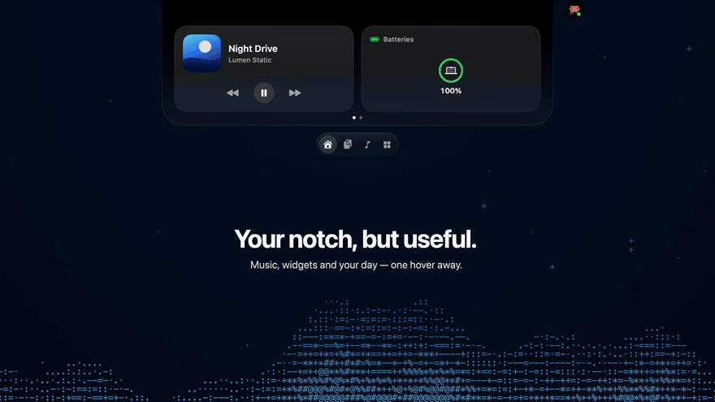

**[Download for Mac](https://github.com/CezarProX/brim/releases/latest)** · [Features](#features) · [Install](#install) · [Build from source](#build-from-source)

</div>

## Features

Brim is a free, open-source menu-bar app. It turns the notch, or a small island at the top of
any display, into a home for the things you reach for all day.

<table>
  <tr>
    <td width="50%" valign="top">
      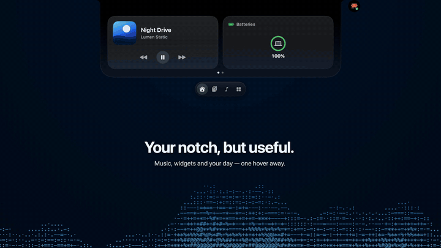
      <h3>Music, one glance up</h3>
      Apple Music, Spotify and YouTube Music with artwork, controls, synced lyrics and the Playing Next queue.
    </td>
    <td width="50%" valign="top">
      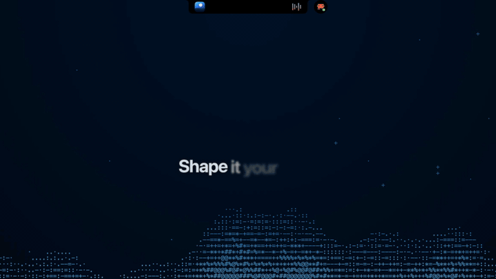
      <h3>Shape it your way</h3>
      Pick your widgets, then drag them where you want them on the Home page.
    </td>
  </tr>
  <tr>
    <td width="50%" valign="top">
      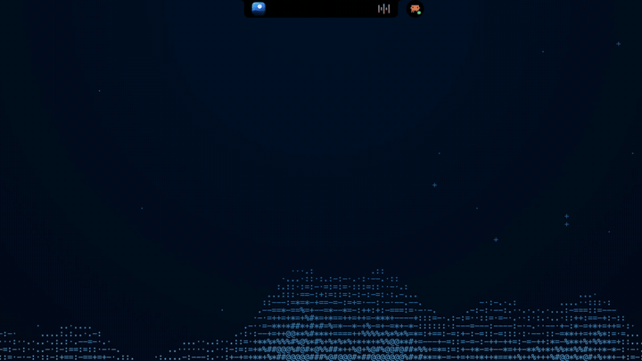
      <h3>Park files in the notch</h3>
      Drop files on the notch to keep them within reach, then drag them back out, AirDrop them or convert them.
    </td>
    <td width="50%" valign="top">
      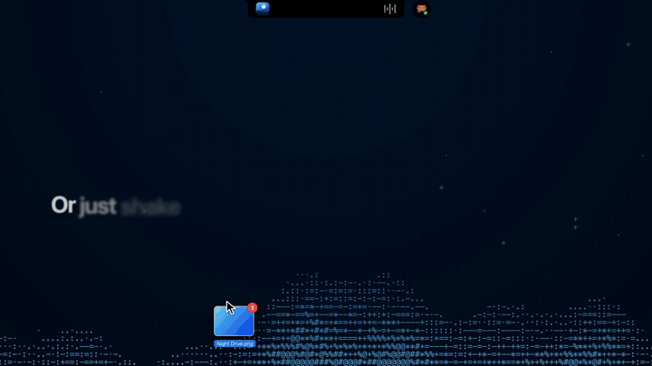
      <h3>Or just shake it</h3>
      Shake the pointer while dragging files and quick actions pop up right where you are.
    </td>
  </tr>
  <tr>
    <td width="50%" valign="top">
      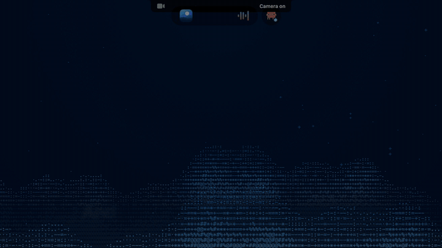
      <h3>Live Activities</h3>
      Volume, brightness, battery, AirPods, Caps Lock, camera and microphone in use, all drawn in the island.
    </td>
    <td width="50%" valign="top">
      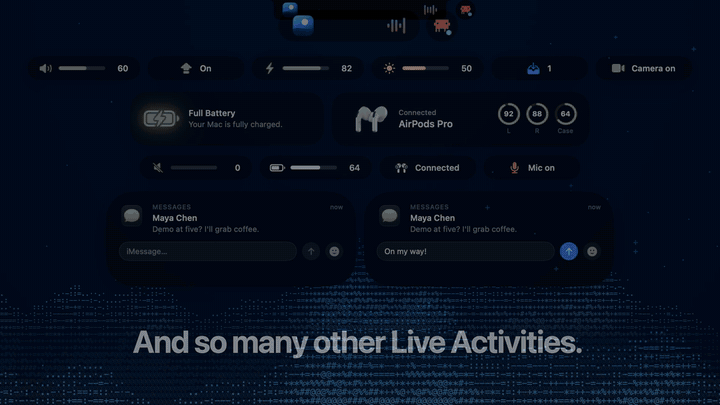
      <h3>Reply on the go</h3>
      Messages show up in the island, and you can answer without leaving what you are doing.
    </td>
  </tr>
  <tr>
    <td width="50%" valign="top">
      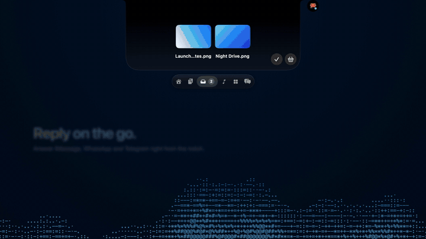
      <h3>Every copy you make</h3>
      Text, links, colors, files and images as cards, with search, tags, pinning and on-device text recognition.
    </td>
    <td width="50%" valign="top">
      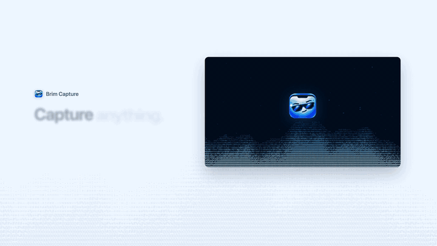
      <h3>Capture anything</h3>
      Press <code>⌘⇧9</code> and drag across any display. A thumbnail waits in the corner for a quick drag into any app.
    </td>
  </tr>
  <tr>
    <td width="50%" valign="top">
      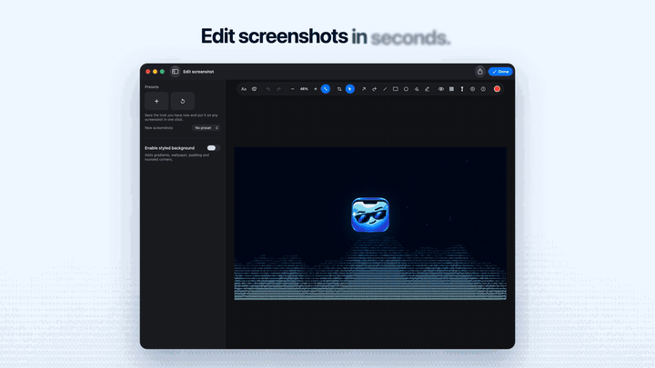
      <h3>Edit screenshots in seconds</h3>
      Arrows, shapes, text and highlights, then copy, save, upload, print or share.
    </td>
    <td width="50%" valign="top">
      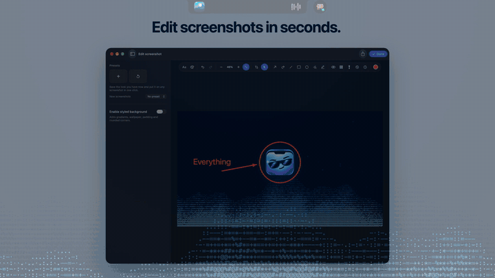
      <h3>Your day at a glance</h3>
      Events and reminders with a month view and quick add in plain language.
    </td>
  </tr>
  <tr>
    <td width="50%" valign="top">
      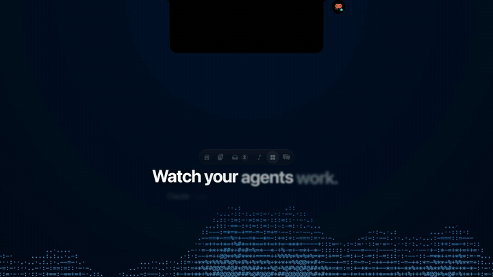
      <h3>Watch your agents work</h3>
      Claude Code and Codex sessions live in the notch, and you can answer their questions from there.
    </td>
    <td width="50%" valign="top">
      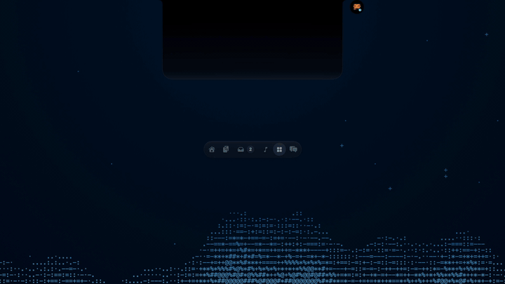
      <h3>And a whole toolbox</h3>
      Timers and Pomodoro, notes, system stats, Keep Awake, voice memos, file Transform and more.
    </td>
  </tr>
</table>

<div align="center">
  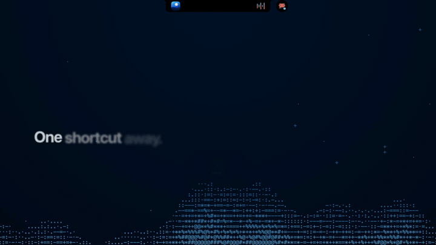
  <h3>One shortcut away</h3>
  <p><code>⌥⌘R</code> opens the Ring wherever your pointer is: capture, grab text, pick a color, play or pause, and more.</p>
</div>

Also inside: optional lock-screen cards for music and timers, a floating island on displays
without a notch, and an interface in English and Romanian.

## Requirements

- A Mac with Apple silicon and macOS 14 Sonoma or later. Notch features work on any display;
  Macs without a notch get a floating island.
- To build: Xcode 26 or later (the Liquid Glass code needs the macOS 26 SDK).

## Install

Download the latest `Brim.dmg` from [Releases](https://github.com/CezarProX/brim/releases) and drag
Brim to Applications.

Releases are not notarized by Apple yet, so the first launch is blocked. Open **System Settings →
Privacy & Security**, scroll down to the message about Brim and click **Open Anyway**. You only
need to do this once.

The island itself needs no privacy permissions. If you only see Command Center, click its
**Open Island** button (the island icon in the header), or right-click Brim's menu-bar icon and
choose **Open Island**. This also re-enables the island on the current display and keeps it open
until you move the pointer onto it and then away. New installs keep the island visible over fullscreen apps; you can opt into hiding it in Settings → Island.

## Updates

**Current release: [Brim 1.0.7](https://github.com/CezarProX/brim/releases/tag/v1.0.7).**

From 1.0.5, releases reuse the same publisher certificate and bundle identifier so macOS can
recognize the app across updates. Moving from the older ad-hoc builds may require one final
permission grant. This is still a self-signed, non-notarized build, not an Apple Developer ID release.

Hovering a microphone, camera, Focus or Hotspot indicator opens your Home widgets instead of a blank black page.

Home Media now includes a playback timeline and volume control. Click the cover or title to open
the song in its player, and the artist to open their page or a search in the same service. Home’s
remove and resize buttons stay still while editing and have larger click targets. This release
also includes the fixes for clipped activity bubbles and the introduction appearing over fullscreen apps.

From version 1.0.1, Brim checks for signed GitHub releases in the background. When one is
available, click the green update arrow in the island, then choose **Install Update** in the
update window. Brim downloads the update, replaces the app and relaunches; you keep your settings.
You can also right-click the island’s navigation bar and choose **Check for Updates**.

Users on 1.0.0 need to download and install the current release, **1.0.7**, once to get the updater. Future updates install
from the app. Publishing a signed GitHub release makes it available to installed copies; pushing
source changes alone does not. See [Releasing](docs/RELEASING.md).

## Permissions

Brim asks for each permission when you first use the feature that needs it, or from the
introduction shown on first launch (Settings → About → Replay introduction).

| Permission | What it is for |
|---|---|
| Screen Recording | Screenshots and screen recordings. Quit and reopen Brim after allowing it. |
| Accessibility | Replacing system HUDs, call controls, notifications in the island, YouTube Music app metadata |
| Automation | Music and Spotify controls, browser tabs, the Dark Mode switch |
| Calendar and Reminders | Your next event and the agenda (optional) |
| Notifications | Capture confirmations and alerts |
| Microphone, Camera, Speech Recognition | Voice memos, dictation, the camera mirror and recording narration (only when you use them) |
| Location | Weather for your area, if you choose automatic location |
| Local Network | Sending files to nearby devices with LocalSend |

## Privacy

Everything runs on your Mac. Brim has no accounts, analytics or telemetry. It checks GitHub
Releases for signed updates once a day; you can turn background checks off in Settings → About.
It also goes online for features you turn on or use: lyrics, weather, and uploading a screenshot
when you press Upload. The first upload to a host tells you where it goes and asks first. The full list, and
what each service receives, is in [THIRD_PARTY_NOTICES.md](THIRD_PARTY_NOTICES.md).

Brim uses a few private macOS frameworks (MediaRemote for now playing, SkyLight for the lock
screen, DisplayServices and CoreBrightness for the HUDs). They may change with any macOS update,
and they are why Brim is distributed here rather than on the Mac App Store.

## Shortcuts

| Shortcut | Action |
|---|---|
| `⌘⇧9` | Capture an area |
| `⌥⌘N` | Open or close the island |
| `⌥⌘R` | Ring menu at the pointer |
| `⌥⇧Space` | Clipboard history |
| `⌥⌘E` | Emoji picker |

All of them can be changed or turned off in Settings → Shortcuts.

During a capture:

| Shortcut | Action |
|---|---|
| `⌘C` | Copy |
| `⌘S` | Save |
| `⌘U` | Upload |
| `⌘P` | Print |
| `⌘Z` / `⌘⇧Z` | Undo / redo |
| `Enter` | Confirm (also copies if "Copy automatically after selection" is on in Settings → Clipboard) |
| `Delete` | Remove the selected annotation |
| `Esc` | Cancel |

## Build from source

Brim is a Swift package using Sparkle for signed in-app updates.

```bash
git clone https://github.com/CezarProX/brim.git
cd brim
swift build                              # debug build
swift test --no-parallel                 # the test suite
BRIM_ALLOW_ADHOC=1 ./build_app.sh        # build/Brim.app, ad-hoc signed
open build/Brim.app
```

`build_app.sh` uses an Apple Development certificate when you have one, so macOS keeps the
permissions you granted across rebuilds. With an ad-hoc build, macOS may ask for Screen Recording
and Accessibility again after every rebuild. Set `BRIM_SIGNING_IDENTITY` to pick a specific
certificate.

See [ARCHITECTURE.md](ARCHITECTURE.md) for how the code is laid out.

## Contributing

Bug reports, ideas and pull requests are welcome. Please read [CONTRIBUTING.md](CONTRIBUTING.md)
first, and report security problems privately as described in [SECURITY.md](SECURITY.md).

## License

Brim is free software under the [GNU General Public License v3.0](LICENSE). Credits for the
techniques and services it builds on are in [THIRD_PARTY_NOTICES.md](THIRD_PARTY_NOTICES.md).

Brim is an independent project and is not affiliated with Apple Inc.
